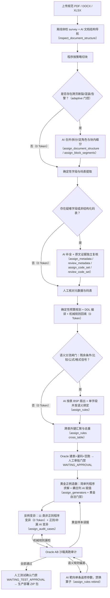

# Data Rule Studio（`data-rule-studio`）— 数据规则装配与验证台

> **统一 Data Agent 产品家族**：[`data-rule-studio`](https://github.com/shawhang0336-blip/data-rule-studio)（规则装配与验证） · [`data-biz-copilot`](https://github.com/shawhang0336-blip/data-biz-copilot)（业务资产与制度对账） · [`data-sql-guardian`](https://github.com/shawhang0336-blip/data-sql-guardian)（SQL 优化与发布门禁）

面向金融监管报送与数据质量场景的**确定性工具 + 受控 AI 参数赋值**工作台：覆盖监管规范文档解析、表字段元数据与码表核对、Oracle/MySQL 建表与校验规则装配、人工确权、Oracle 沙箱黄金正例造数与靶向反例变异验证，到生产校验 SQL 部署 ZIP 包一键交付。

---

## 核心特性与架构原则

- **三步端到端工作台**
  1. **规范解析与核对**：支持 PDF / DOCX / XLSX 规范文档接入、AI 结构体检与切块、表字段与公共/内联码表双轨并行提取、人工抽屉修订、CSV/XLSX 批量修正与就绪度检查。
  2. **生成表结构、码表和规则**：确定性预算规划与 DDL 编译、13 类监管算子规则生成、Oracle 沙箱空跑预检、规则手工改参与人工审批确权。
  3. **测试与下载**：AI 黄金正例造数 + 确定性反例变异、Oracle AB 沙箱真跑与三路自愈、测试确认门禁、生产 DDL / 只读校验 SQL 部署 ZIP 包防篡改打包下载，并支持跨版本制度文档 Diff 与跨批次 SQL Diff。
- **后端架构（ProdAgent「机制在内，策略在外」+ 严格单向八层 DAG）**
  - 六大微内核（`Plan` / `Bus` / `EventLog` / `Interrupt` / `Run` / `Scheduler` 真 BSP `Send` 波次引擎）与业务策略彻底隔离；
  - 全链路以只追加哈希链事件账本（`EventLog`）与内容寻址大对象存储（`BlobStore`）为唯一事实源，支持门禁拦截、一等人工中断挂起、横切成本熔断（`BudgetGuard`）、运行中取消、断点续跑与 SSE 实时事件推送；
  - 统一收口全部 `/api/*` 接口（无历史 `/api/v2` 分叉），`api/` 按四大业务域采用**薄路由 + 服务分离**，严禁跨路由互调。
- **前端架构（与后端四大业务域 1:1 对称）**
  - React 19 + Vite 7，路由级 `React.lazy` 懒加载分包；
  - 全站 `/api/*` 请求集中收口在 `frontend/src/api/`，业务模块按 `platform / catalog / generation / delivery` 与后端一一对应，公共组件与纯工具严格单向依赖。

详细架构说明与阅读路线：
- 后端架构导览：[backend/ARCHITECTURE.md](backend/ARCHITECTURE.md)
- 前端架构导览：[frontend/ARCHITECTURE.md](frontend/ARCHITECTURE.md)
- 监管规范背景资料：[docs/SAFE_1.4_修订说明与来源索引.md](docs/SAFE_1.4_修订说明与来源索引.md)

---

## 目录结构

```text
data-rule-studio/
├── backend/                          # FastAPI 后端（严格单向八层 DAG）
│   ├── ARCHITECTURE.md               # 后端八层架构导览与 AST 红线说明
│   ├── app/
│   │   ├── main.py                   # 极简 FastAPI 启动入口（lifespan / CORS / register_routers）
│   │   ├── infra/                    # 层 0：基础设施、20 张 ORM 表、BlobStore、受控 LLM 客户端
│   │   ├── kernel/                   # 层 1：ProdAgent 六大核心微内核（零业务依赖）
│   │   ├── policy/                   # 层 2：监管业务策略装配（Plan / Bus 门禁 / Channels）
│   │   ├── ingestion/                # 层 3：文档拆箱、纯离线解析器、AI 结构切块与进度广播
│   │   ├── catalog/                  # 层 4：监管资产目录（tables / code_sets / 并发提取 / 版本 Diff）
│   │   ├── generation/               # 层 5：纯离线规则内核（core）、MySQL/Oracle SQL 编译与前段 BSP
│   │   ├── delivery/                 # 层 6：造数变异与 AB 沙箱审计（testing）、总调度、Run Diff 与生产打包
│   │   └── api/                      # 层 7：统一 /api/* 接口层（common.py + 4 大业务域薄路由与服务）
│   │       ├── __init__.py           #   唯一路由装配入口 register_routers(app)
│   │       ├── common.py             #   跨域公共依赖（db_session / spawn_run_driver / run_view）
│   │       ├── platform/             #   /api/health、/api/events/stream、/api/blobs/*、/api/settings/*
│   │       ├── catalog/              #   /api/documents/*、/api/metadata/*、/api/code-sets/*
│   │       ├── generation/           #   /api/generation/*、/api/artifacts/*
│   │       └── delivery/             #   /api/runs/*
│   ├── migrations/                   # Alembic 数据库迁移脚本
│   └── tests/                        # 后端全量单测、深审回归与 AST 架构红线守卫
├── frontend/                         # React + Vite 前端工作台（与后端四域 1:1 对称）
│   ├── ARCHITECTURE.md               # 前端目录分层与依赖守卫说明
│   ├── src/
│   │   ├── main.jsx                  # 唯一挂载入口
│   │   ├── app/                      # 应用外壳、顶栏导航、路由表与健康探测
│   │   ├── api/                      # 全站统一接口客户端（client / platform / catalog / generation / delivery）
│   │   ├── components/               # 通用 UI 组件（PageHeader / StatusMessage / StatusBadge / Modal 等）
│   │   ├── context/                  # ThemeContext / FeedbackContext
│   │   ├── hooks/                    # Bus SSE 订阅与进度监听（useEventStream）
│   │   ├── utils/                    # 纯工具函数与文案词典（dateTime / budget / activeDocument / labels）
│   │   ├── styles/                   # 全局样式收口（index.css 固定层叠顺序）
│   │   └── features/                 # 按 4 大业务域组织的页面模块（catalog / generation / delivery / platform）
│   └── tests/                        # 前端单测与架构边界自动化守卫（node --test）
├── docs/                             # 监管规范背景资料与修订索引
├── data/specs/                       # 本地监管 PDF 原件目录（.gitignore 忽略，不入库）
├── .env.example                      # 环境变量模板
└── README.md
```

### 前后端四大业务域对照

| 业务域 | 前端页面（`frontend/src/features/`） | 前端接口（`frontend/src/api/`） | 后端接口（`backend/app/api/`） | 职责范围 |
| --- | --- | --- | --- | --- |
| `catalog` | `catalog/`（工作台、文档、元数据、码表、变更记录） | `catalog.js` | `catalog/`（`documents` / `metadata` / `code_sets`） | 规范接入、切块提取、表字段/码表核对与文档 Diff |
| `generation` | `generation/`（规则工作台与规则编辑抽屉） | `generation.js` | `generation/`（`generation` / `artifacts`） | 规则/表结构/码表产物聚合、规则改参、发起生成与打包下载 |
| `delivery` | `delivery/`（测试与下载、追踪瀑布、历史清理） | `delivery.js` | `delivery/`（`runs`） | 运行批次控制、规则审批、测试确认、沙箱预览与批次 Diff |
| `platform` | `platform/`（系统设置） | `platform.js` | `platform/`（`system` / `settings`） | 健康探测、SSE 事件流、Blob 读取、连接探活与执行预算 |

---

## AI 如何介入本项目（确定性优先 + 受控参数赋值）

**一句话讲透：在这个项目里，AI 只负责「看懂监管原文、填好配置单」，绝不亲自下场「干活」（写 SQL、操作数据库、做最终裁决）。**

打个比方：**AI 是“读规范的业务分析师”，确定性程序才是“按图纸施工的工程师和质检员”**。AI 读完中文监管文档后，只能按程序给好的固定表单勾选算子、填写结构化参数；之后怎么把参数编译成 Oracle / MySQL 语句、怎么建表灌测试数据、怎么验证规则有效、怎么打生产部署包，**全部由 100% 确定性的程序代码执行**。

**为什么要这样设计，不让 AI 直接下场干全套？**

1. **监管报送零容忍“幻觉”**：如果让 AI 直接手写 SQL，很容易出现编造字段名/表名、混淆 Oracle 与 MySQL 方言（如空串与 `NULL`、字符长度与字节长度）、写漏或写错码表枚举等问题；金融监管场景下，一条漏检或误报都会直接影响报送合规。
2. **结果必须可校验、可复现、可审计**：自由生成的代码跑十次可能写出十种写法，出了问题很难追责；把 AI 收口为「填结构化参数」后，每个字段名、算子、码值在生效前都会被程序白名单硬校验，再进 Oracle 沙箱用正反测试数据真跑验证，全过程留痕可回放。
3. **把 Token 和时间只花在真正的“语义硬骨头”上**：一份监管规范里大量工作是机械的（必填、字段长度上限、已发布码表比对、常规异常数据变异），程序毫秒级就能 0 成本做对；只把真正需要读懂中文语义的部分（跨页混装切块、条件必填、跨字段比较、算术平衡勾稽、正则格式）交给 AI，又快又稳又省钱。
4. **AI 只是副驾驶，人工握着最终闸门**：AI 推断出的规则不能静默上线，必须经过人工审批；沙箱测试全部通过后，也必须经人工确认才能导出带防篡改校验的生产部署包。

### 1. 介入红线：AI 做什么 vs 绝不做什么

| 维度 | AI 负责（受控 Tool-Call 赋值） | 确定性程序负责（0 Token，零幻觉） |
| --- | --- | --- |
| **输出形式** | 只能调用预定义 JSON Schema 工具返回结构化参数（严禁输出 SQL 或自由文本） | 校验、编译、落库、执行与打包全部由确定性代码完成 |
| **SQL 与 DDL** | 绝不直接生成任何 SQL / DDL | `generation/sql/compiler.py` 与 `code_set_sql.py` 确定性编译 Oracle / MySQL 8 DDL、码表 `MERGE/UPSERT` 与 13 类算子校验 SQL |
| **规划与基础规则** | 不参与预算规划、基础表结构与常规机械规则 | `derive_generation_plan`（预算规划）、`compile_schema`（表结构）、`rule_backfill.py`（必填 / 列宽上限 / 固定值 / 已发布码表白名单）全确定性执行 |
| **验证与交付** | 仅负责复杂语义字段的造数参数与正则反例构造，失败时定向返修参数 | `OracleSandbox` 真实建表/灌数/真跑裁决；人工 `Interrupt` 审批门禁 + 防篡改哈希校验锁死生产包导出 |

### 2. 全链路 AI 介入流程



### 3. 全仓库受控 AI 工具介入明细

全项目全部受控工具契约集中定义在 [`backend/app/infra/llm/schemas.py`](backend/app/infra/llm/schemas.py)，按四个业务阶段精确分工：

| 阶段 | 工具名 | 触发条件（如何省 Token） | AI 职责与硬边界 | 对应源码 |
| --- | --- | --- | --- | --- |
| **规范接入** | `inspect_document_structure` | 每份新文档切块前 1 次 | 基于离线 `survey` 摘要，从该文件类型合法策略白名单内选择切块策略并标注章节角色（`TABLE_METADATA / CODE_SET / IGNORE`）；非法策略自动回退程序默认值 | [`structure_service.py`](backend/app/ingestion/structure_service.py) |
| **规范接入** | `assign_document_structure` | 默认 `adaptive` 模式：**仅跨页断裂、混装或带告警的章节调用**；结构清晰块 0 Token 跳过 | 决定合并 `source_block_ids`、原文 `split_markers` 切分或纠正角色；禁止拆坏已解析的 `parsed_spec`，所有块 ID 受白名单校验 | [`structure_service.py`](backend/app/ingestion/structure_service.py) |
| **规范接入** | `assign_block_segments` | 仅对需细分的混装大块触发 | 标出术语 / XML / 数据字典 / 码值 / 主键的逐字起止标记，由程序按偏移切出子块并保留父块证据链 | [`structure_service.py`](backend/app/ingestion/structure_service.py) |
| **资产目录** | `assign_metadata` | **确定性先行**：要素齐全字段毫秒级落库；仅缺类型/英文名/有解析告警的疑难字段或纯文本块小批次调用 | 补齐字段中文名、英文名、类型、长度与校验原文；校验返回字段数完全匹配，异常自动退回确定性映射 | [`catalog/tables/service.py`](backend/app/catalog/tables/service.py) |
| **资产目录** | `review_metadata` | 仅在本次提取实际使用过 AI 时触发 | 独立复核整表元数据；强制每条问题附逐字原文 `evidence`，**严禁用业务常识替代原文报 `ERROR`**（无依据强制降级 `WARNING`） | [`catalog/tables/service.py`](backend/app/catalog/tables/service.py) |
| **资产目录** | `assign_code_set` / `review_code_set` | 结构化码表与内联枚举先走程序/正则；仅正则无果的非结构化码表走 AI 兜底；复核带防幻觉护栏 | 提取码值项或复核遗漏/错配；`enforce_code_set_review_evidence` 自动过滤无原文支撑的误报 | [`catalog/code_sets/service.py`](backend/app/catalog/code_sets/service.py) |
| **规则装配** | `assign_rules`（单表语义） | 经 `needs_semantic_rule_binding` 语义分流：**剥离已覆盖短语后无残余约束信号的字段 0 Token 跳过** | 仅绑定当前 `target_field` 剩余语义规则（`COND_REQUIRED` / `COND_VALUE` / `ARITHMETIC_BALANCE` / `UNIQUE_KEY` / `REGEXP` / `NUM_RANGE` / `FIELD_COMPARE` / `NOT_IN` 等），禁止重复输出机械规则，区分 `DOC_EXPLICIT` 与 `AI_EXPANDED` | [`stage_rules.py`](backend/app/generation/workflow/stage_rules.py) |
| **规则装配** | `assign_rules`（跨表外键） | 仅多表批量生成时触发 1 次 | 装配跨表 `FOREIGN_KEY` 及可选 `golden_overrides`；源表/目标表/字段均受跨表白名单硬拦截 | [`stage_rules.py`](backend/app/generation/workflow/stage_rules.py) |
| **沙箱验证** | `assign_generators` | 简单列、数值区间、独立唯一键优先程序确定性求解；**仅剩余耦合列按跨字段约束连通分量打包调 AI** | 为黄金正例 A 分配 `FIXED / ENUM / SEQUENCE` 生成器；返回后必须立即通过**黄金自洽门禁**（`find_golden_rule_violations` 零违规）才能落库 | [`stage_data.py`](backend/app/delivery/testing/stage_data.py) |
| **沙箱验证** | `assign_audit_cases` | **11 类非正则算子 100% 确定性变异（0 Token）**；仅正则规则或自愈补漏规则调 AI | 构造贴近业务的精准违规反例 B；若 AI 仍失败，自动触发正则确定性兜底变异（`build_regexp_fallback_mutation`） | [`stage_audit.py`](backend/app/delivery/testing/stage_audit.py) |
| **三路自愈** | `assign_rules`（单条返修） / `assign_generators` / `assign_audit_cases` | 仅 Oracle 沙箱审计未全通过且未超最大尝试次数时定向触发 | 严格分流：①黄金误报只修造数不改规则；②机械规则漏检只重造变异用例；③语义规则偏差只修订该条规则 `params` 且**严禁擅自更换 `operator`** | [`nodes_back.py`](backend/app/delivery/testing/nodes_back.py) |

> 注：`schemas.py` 中仍保留 `assign_generation_plan` 与 `assign_schema` 作为兼容契约定义，但主流程现已全部收敛为纯确定性实现（[`planning.py`](backend/app/generation/core/planning.py) 与 [`binding.py`](backend/app/generation/core/binding.py)），运行时不消耗任何 Token。

### 4. 五重运行时护栏（把 AI 关进确定性笼子）

所有业务阶段的 LLM 调用必须经过 [`call_llm_validated`](backend/app/infra/llm/guard.py)，严禁裸调模型接口：

1. **作用域最小化契约（[`schemas.py`](backend/app/infra/llm/schemas.py)）**
   按工具动态拼装最小前置约束（文档解析阶段不会混入规则算子说明书），算子枚举仅暴露 `LLM_OPERATORS`（禁用 `LENGTH` 等易误报算子，统一用 `LENGTH_MAX` 表示列宽上限、`REGEXP` 表示精确位数格式）。
2. **五大确定性事前 Bus 门禁（[`regops_bus.py`](backend/app/policy/regops_bus.py)）**
   在任何业务逻辑消费 AI 输出之前，单次 Run 的 Bus 自动执行五道白名单裁决：
   - `field_whitelist_adjudicator`：拦截幻觉字段名（含 `if_field` / `right_field` / `terms[].field` / `key_fields[]` / 变异 `overrides`）；
   - `cross_table_adjudicator`：拦截不在已确认表/字段白名单内的跨表引用与 `golden_overrides`；
   - `operator_whitelist_adjudicator`：拦截非 `LLM_OPERATORS` 算子；
   - `code_set_values_adjudicator`：拦截不在已发布码表值域内的 `ENUM` / `COND_VALUE` / 生成器取值；
   - `structure_block_adjudicator`：拦截虚构的切块 `source_block_ids`。
3. **分轨容错与拒绝原因自动回喂（[`guard.py`](backend/app/infra/llm/guard.py)）**
   - **网络 / 超时 / 429 / 5xx 瞬时错**：消耗 `transient_attempts`（默认 4 次），带随机抖动退避等待并逐次放宽超时窗口；
   - **漏调工具 / Bus 门禁拦截 / 业务 validator 拒收**：消耗 `validation_attempts`（默认 3 次），零等待立即把精确拒收原因作为 `feedback` 回喂模型自我修正，并将拦截明细记入 `bus_rejections`；
   - **鉴权或配置致命错误**：快速失败，不空耗重试预算。
4. **横切预算熔断与协作式取消（`llm_execution_scope` + `BudgetGuard`）**
   通过 `contextvars` 穿透多线程并发 Worker，实时统计 `llm_calls`、`total_tokens` 与 `elapsed_seconds`（可在「系统设置」页配置上限）；触发预算上限立即熔断，操作员点击中止时可在退避等待中即时唤醒退出。
5. **全量可回放审计与离线模式（`EventLog` + `scripted`）**
   每次 AI 赋值入参/出参、门禁拦截记录、Token 消耗与耗时均追加写入带 SHA-256 哈希链的不可变事件账本，前端批次详情页可完整回放追踪；同时支持 `LLM_PROVIDER=scripted` 离线确定性模式零成本跑通回归测试。

---

## 本地启动

### 1. 环境配置

复制环境变量模板并按本地环境填写数据库与模型配置：

```bash
cp .env.example .env
```

常用配置项（详见 [`.env.example`](.env.example)）：
- `DATABASE_URL`：应用管理库连接串（本地默认 SQLite，生产/联调推荐 MySQL 8+ `mysql+pymysql://...`）
- `ORACLE_SANDBOX_URL`：Oracle 验证沙箱连接串（用于真跑建表、造数与规则验证）
- `LLM_PROVIDER` / `LLM_BASE_URL` / `LLM_MODEL` / `LLM_API_KEY`：OpenAI 兼容大模型配置（`scripted` 为离线脚本模式）
- `SAFE_13_SPEC_PATH`：可选，如需运行外管 1.3 规范全量解析测试，可将 `金融机构外汇业务数据采集规范_1.3版_全文.pdf` 放入 `data/specs/`

### 2. 启动后端

```bash
python3 -m venv .venv
source .venv/bin/activate
pip install -e "backend[dev]"

cd backend
alembic upgrade head
uvicorn app.main:app --reload --host 127.0.0.1 --port 8000
```

### 3. 启动前端

```bash
cd frontend
npm install
npm run dev
```

默认前端地址为 `http://127.0.0.1:5173`，Vite 会将 `/api/*` 请求代理到 `http://127.0.0.1:8000`。

---

## 测试与架构守卫

```bash
# 后端全量测试（含八层 DAG、内核纯净度、API 零跨路由依赖等 AST 架构守卫）
cd backend && pytest -q

# 前端单测与架构边界守卫（含目录结构、/api/* 统一收口与单向依赖校验）
cd frontend && npm test

# 前端生产构建验证
cd frontend && npm run build
```
